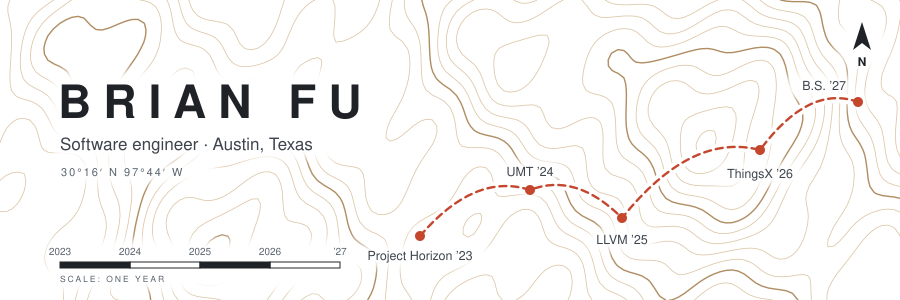
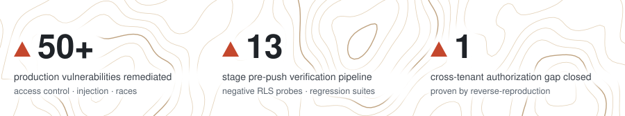
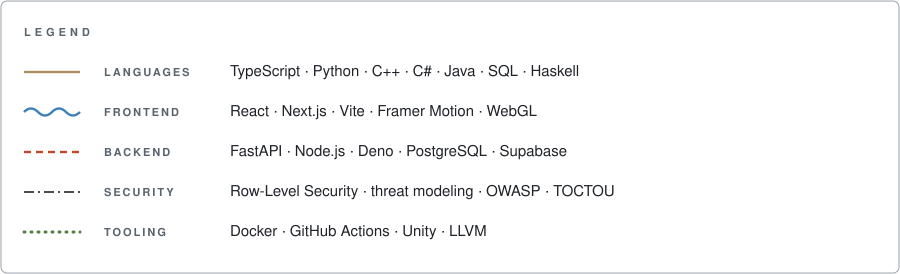
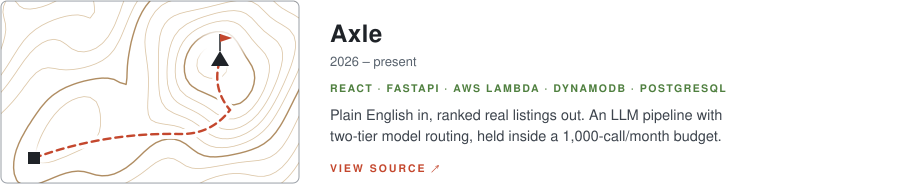
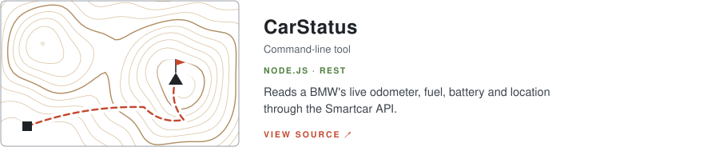
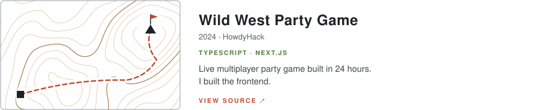
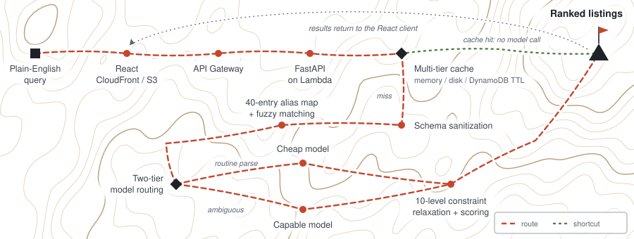

<picture>
  <source media="(prefers-color-scheme: dark)" srcset="https://raw.githubusercontent.com/jiacheng-fu/jiacheng-fu/main/assets/topo/header.svg" />
  
</picture>

<picture>
  <source media="(prefers-color-scheme: dark)" srcset="https://raw.githubusercontent.com/jiacheng-fu/jiacheng-fu/main/assets/topo/sec-about.svg" />
  
</picture>

CS student at **Texas A&M** in Austin, TX — B.S. December 2027 (3.87 GPA, math minor). I build and ship full-stack products end to end, work on **application security** for a production multi-tenant SaaS platform, and spent a summer writing an **LLVM compiler backend** for a vector DSP.

**Live:** [brianfu.vercel.app](https://brianfu.vercel.app) · [Axle](https://d1j3m9qdbgs5ik.cloudfront.net)

<picture>
  <source media="(prefers-color-scheme: dark)" srcset="https://raw.githubusercontent.com/jiacheng-fu/jiacheng-fu/main/assets/topo/stats.svg" />
  
</picture>

<picture>
  <source media="(prefers-color-scheme: dark)" srcset="https://raw.githubusercontent.com/jiacheng-fu/jiacheng-fu/main/assets/topo/sec-stack.svg" />
  
</picture>

<picture>
  <source media="(prefers-color-scheme: dark)" srcset="https://raw.githubusercontent.com/jiacheng-fu/jiacheng-fu/main/assets/topo/stack.svg" />
  
</picture>

<picture>
  <source media="(prefers-color-scheme: dark)" srcset="https://raw.githubusercontent.com/jiacheng-fu/jiacheng-fu/main/assets/topo/sec-projects.svg" />
  
</picture>

<a href="https://github.com/jiacheng-fu/axle">
<picture>
  <source media="(prefers-color-scheme: dark)" srcset="https://raw.githubusercontent.com/jiacheng-fu/jiacheng-fu/main/assets/topo/proj-axle.svg" />
  
</picture>
</a>

<a href="https://github.com/jiacheng-fu/personal-website">
<picture>
  <source media="(prefers-color-scheme: dark)" srcset="https://raw.githubusercontent.com/jiacheng-fu/jiacheng-fu/main/assets/topo/proj-site.svg" />
  
</picture>
</a>

<a href="https://github.com/jiacheng-fu/project-horizon">
<picture>
  <source media="(prefers-color-scheme: dark)" srcset="https://raw.githubusercontent.com/jiacheng-fu/jiacheng-fu/main/assets/topo/proj-horizon.svg" />
  
</picture>
</a>

<a href="https://github.com/jiacheng-fu/CarStatus">
<picture>
  <source media="(prefers-color-scheme: dark)" srcset="https://raw.githubusercontent.com/jiacheng-fu/jiacheng-fu/main/assets/topo/proj-car.svg" />
  
</picture>
</a>

<a href="https://github.com/jiacheng-fu/wild-west-party-game">
<picture>
  <source media="(prefers-color-scheme: dark)" srcset="https://raw.githubusercontent.com/jiacheng-fu/jiacheng-fu/main/assets/topo/proj-west.svg" />
  
</picture>
</a>

<picture>
  <source media="(prefers-color-scheme: dark)" srcset="https://raw.githubusercontent.com/jiacheng-fu/jiacheng-fu/main/assets/topo/sec-architecture.svg" />
  
</picture>

How **Axle** turns a plain-English question into ranked listings — and stays inside a 1,000-call/month model budget.

<picture>
  <source media="(prefers-color-scheme: dark)" srcset="https://raw.githubusercontent.com/jiacheng-fu/jiacheng-fu/main/assets/topo/arch-map.svg" />
  
</picture>

Two things hold the budget: repeat questions never reach a model, and only genuinely ambiguous ones reach the expensive one. The relaxation ladder is why a query with no exact match still returns ranked results instead of an empty page.

<picture>
  <source media="(prefers-color-scheme: dark)" srcset="https://raw.githubusercontent.com/jiacheng-fu/jiacheng-fu/main/assets/topo/sec-activity.svg" />
  
</picture>

<picture>
  <source media="(prefers-color-scheme: dark)" srcset="https://raw.githubusercontent.com/jiacheng-fu/jiacheng-fu/output/github-snake-dark.svg?v=7" />
  
</picture>

<picture>
  <source media="(prefers-color-scheme: dark)" srcset="https://raw.githubusercontent.com/jiacheng-fu/jiacheng-fu/main/assets/topo/sec-contact.svg" />
  
</picture>

<a href="https://linkedin.com/in/jiachengfu"><picture><source media="(prefers-color-scheme: dark)" srcset="https://raw.githubusercontent.com/jiacheng-fu/jiacheng-fu/main/assets/topo/sign-linkedin.svg" /></picture></a> <a href="mailto:brian.fu123321@gmail.com"><picture><source media="(prefers-color-scheme: dark)" srcset="https://raw.githubusercontent.com/jiacheng-fu/jiacheng-fu/main/assets/topo/sign-email.svg" /></picture></a> <a href="https://github.com/jiacheng-fu"><picture><source media="(prefers-color-scheme: dark)" srcset="https://raw.githubusercontent.com/jiacheng-fu/jiacheng-fu/main/assets/topo/sign-github.svg" /></picture></a>
